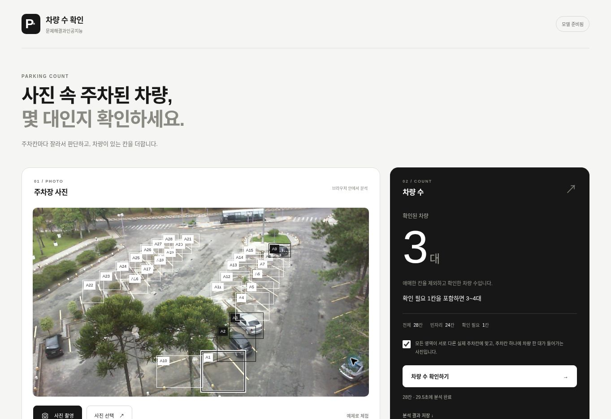

# Netlify 정적 배포

- 공개 데모: https://stunning-khapse-d705ce.netlify.app/
- 배포 디렉터리: `dist/`
- 빌드 명령: 없음
- 환경 변수: 필요 없음

## 자신의 사이트에 배포하기

저장소를 Netlify에 연결하면 루트의 `netlify.toml`이 `dist/`를 배포 경로로 지정합니다. CLI나 수동 배포를 사용할 때도 `dist/`만 지정합니다. 저장소 루트, `training/`, `artifacts/`, `.git/`를 웹 루트로 서비스하지 마세요.

위 데모 주소는 프로젝트의 기존 사이트입니다. 새로 사용하는 사람은 자신의 Netlify 사이트를 만들거나 선택해야 합니다. 기존 사이트의 운영 권한이나 계정 설정이 저장소 복제로 함께 전달되지는 않습니다.

Git 연결 시 운영 브랜치, 자동 배포, Deploy Preview 설정을 확인하세요. 저장소 수정·PR 생성·병합이 어떤 배포를 일으키는지는 연결된 사이트 설정에 따라 다릅니다. 이 문서는 배포를 실행하거나 계정·팀 설정을 바꾸지 않습니다.

Cloudflare Pages를 사용할 경우에도 빌드 명령을 비워 두고 출력 디렉터리를 `dist`로 지정합니다.

## 배포 후 확인

- 메인 화면, JavaScript, Worker, 모델 JSON·metadata·weights 요청이 정상 응답하는지 확인합니다.
- **예제로 체험**을 눌러 기본 모델 로딩과 실제 추론이 완료되는지 확인합니다.
- 사진 선택·영역 편집·취소 후 재시도 등은 [브라우저 확인 목록](counting-browser-qa.md)을 참고합니다.
- 정적 사이트에는 별도 로그인 기능이 없습니다. 접근 제한이 필요하면 호스팅 서비스의 접근 제어를 별도로 검토합니다.

공개 GitHub 저장소의 파일은 웹 배포 경로 밖에 있어도 열람할 수 있습니다. `dist/`만 배포하는 설정을 비공개 자료 보호 수단으로 사용하지 마세요.

## 2026-11-04 접속 확인 기록

당시 HTTP 429 문제를 복구한 뒤 아래 결과를 확인했습니다. 과거 시점의 검증 기록이며 현재 가용성을 보장하지 않습니다.

사이트가 Restricted Team에 속해 메인 화면과 정적 파일에서 HTTP 429를 반환했습니다. 사용자 승인 후 정상 Free 팀으로 프로젝트를 이전하자 같은 주소가 HTTP 200으로 복구됐습니다. 원인 확인과 검증 근거는 [복구 이슈 #29](https://github.com/hyscodebase/parking-space-counter/issues/29)에 정리했습니다.

- 공개 파일 33개 모두 HTTP 200. 429, 404, 다운로드 오류 없음.
- JavaScript, Worker, 모델 JSON·metadata·weights, 모델 ZIP 등 비HTML 31개는 로컬 파일과 SHA256 일치.
- HTML 2개의 바이트 차이는 Netlify Pretty URLs의 링크·속성 변환으로 확인.
- 실제 공개 사이트에서 기본 모델 로딩과 **예제로 체험** 분석 완료.
- 예제 28칸: 확인된 차량 3대, 빈자리 24칸, 확인 필요 1칸, 가능한 범위 3~4대.

예제 사진의 출처와 이용 조건은 [데이터 라이선스](../DATA_LICENSE.md)를 참고하세요. 이 결과는 다른 주차장이나 촬영 조건에서의 정확도를 보장하지 않습니다.
